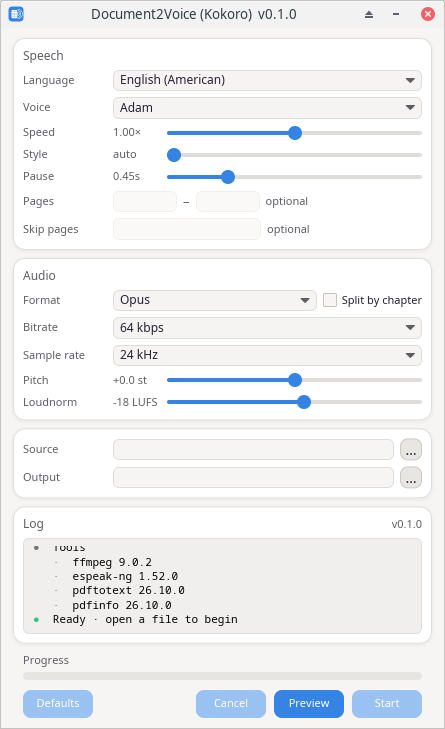

# Document2Voice

Offline documents to spoken audio, with Kokoro neural TTS, packaged as a Linux AppImage.

Open a PDF, EPUB, DOCX, ODT, TXT, or DRM-free Kindle file. Choose a voice. Export Opus, MP3, M4B, WAV, or FLAC — with chapters.

Everything runs **on your machine** — no account, no API key, no cloud.

Written in **Rust**, with a native desktop GUI built on [Iced](https://github.com/iced-rs/iced).

<p align="center"></p>

### Get it

Build the AppImage (see below).

```bash
chmod +x Document2Voice-Kokoro-*-x86_64.AppImage
./Document2Voice-Kokoro-*-x86_64.AppImage
```

Settings: `~/.config/document2voice/`

---

### What you get

| | |
|:--|:--|
| **Speech** | [Kokoro-82M](https://huggingface.co/hexgrad/Kokoro-82M) (ONNX) |
| **Formats** | PDF · EPUB · DOCX · ODT · TXT · DRM-free MOBI/AZW |
| **Pages** | From / to / skip — accurate on PDF |
| **Audio** | Opus · MP3 · M4B · WAV · FLAC · speed · pitch · loudness |
| **Chapters** | From the EPUB table of contents, PDF bookmarks, DOCX/ODT headings, or "CHAPTER I" lines in TXT/Kindle — as chapter markers, or one file per chapter |
| **Preview** | ~10s sample before a full export |
| **Built with** | Rust · [Iced](https://github.com/iced-rs/iced) GUI · [ONNX Runtime](https://onnxruntime.ai/) via [`ort`](https://github.com/pykeio/ort) |

---

### Build the AppImage

```bash
./setup.sh            # once: toolchain + models (~340 MB)
./build-appimage.sh   # → dist/Document2Voice-Kokoro-*-x86_64.AppImage
```

**Dependencies:** the tools the build downloads are pinned to an exact version and checked against a SHA-256: ffmpeg static build, espeak-ng source, micromamba, appimagetool and the AppImage runtime (in `build-appimage.sh`), and Poppler plus its libraries (conda lockfiles in `packaging/appimage/locks/`). A cached file is reused only if its checksum still matches; a mismatch stops the build. The voice models are pinned in `packaging/models.env`, downloaded by `setup.sh` and copied into the image. Rust crates are pinned by `Cargo.lock`. ONNX Runtime is fetched and hash-checked by the `ort-sys` build script.

Set `COPY_TO_DIR=<folder>` to also copy the finished AppImage there as `document2voice.AppImage`.

Output: `dist/` (gitignored).

---

### Command line

The AppImage runs the command-line tool when the first argument is `cli` (or one of its subcommands: `voices`, `extract`, `speak`). From a source checkout the same binary is `target/release/document2voice`.

```bash
APP=./Document2Voice-Kokoro-*-x86_64.AppImage

$APP cli voices                               # English voices (--all for every language)
$APP cli extract book.epub --chapters         # list detected chapters
$APP cli extract book.pdf --pages 4-20 -o book.txt
$APP cli speak "Hello there." -o hello.mp3
$APP cli speak --input book.epub -o book.m4b --voice bm_george --speed 1.1
$APP cli speak --input book.pdf --skip-before 3 -o book --format opus --split-chapters
```

`--out`'s extension picks the format (`.opus`, `.mp3`, `.m4b`, `.flac`, `.wav`); with no extension, `--format` decides (default opus). `document2voice speak --help` lists every option. A DRM-protected input exits with code 2.

---

### License

Copyright (C) 2026 bsd-source

Document2Voice is free software: you can redistribute it and/or modify it under the terms of the [GNU General Public License](LICENSE) as published by the Free Software Foundation, either version 3 of the License, or (at your option) any later version. It is distributed in the hope that it will be useful, but WITHOUT ANY WARRANTY; without even the implied warranty of MERCHANTABILITY or FITNESS FOR A PARTICULAR PURPOSE.

The AppImage also bundles other programs under their own licenses: ffmpeg (GPL-3.0), espeak-ng (GPL-3.0), Poppler's `pdftotext`/`pdfinfo` (GPL-2.0-or-later), the Apache-2.0 Kokoro model, and MIT/Apache-2.0 Rust libraries. Every bundled component's license text and source link is in `usr/share/licenses/document2voice/` inside the image (`THIRD-PARTY-NOTICES.md`).

[GPL-3.0-or-later](LICENSE) · Model: [hexgrad/Kokoro-82M](https://huggingface.co/hexgrad/Kokoro-82M) · UI: [Iced](https://github.com/iced-rs/iced)
